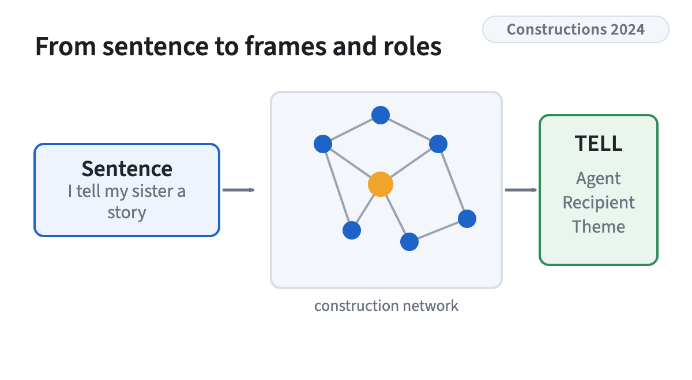
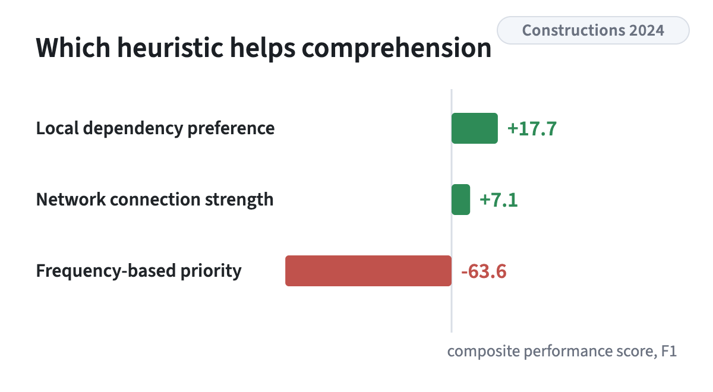

<!-- figstrip -->

<figure><figcaption>A construction grammar extracts the semantic frame and its roles</figcaption></figure>
<figure><figcaption>The frequency-based heuristic hurts, the network heuristic helps</figcaption></figure>

<!-- /figstrip -->
An evaluation of computational construction grammars in Fluid Construction Grammar on semantic frame extraction and semantic role labeling, using OntoNotes and PropBank. It compares three heuristics for resolving competition between constructions and finds that a network-based heuristic performs best, while a purely frequency-based one is harmful.

[DOI](https://doi.org/10.24338/cons-651)

Research theme: [Construction grammar](../research.qmd#construction-grammar)
