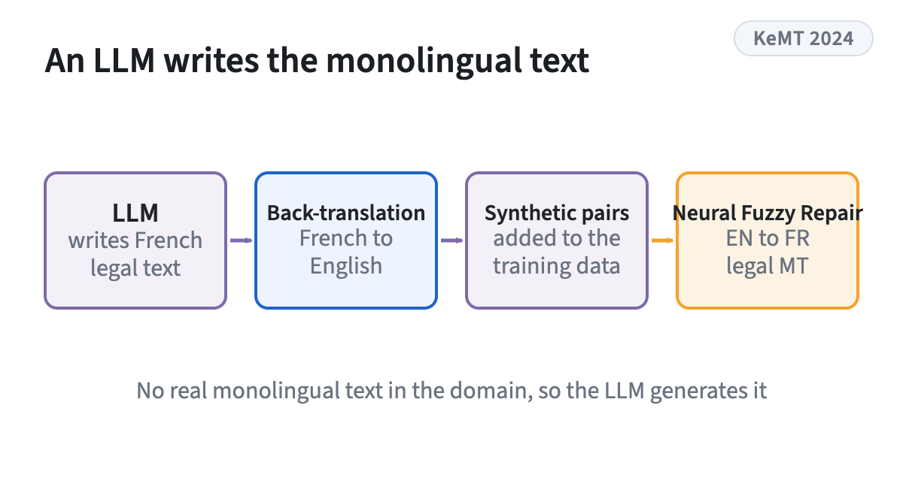
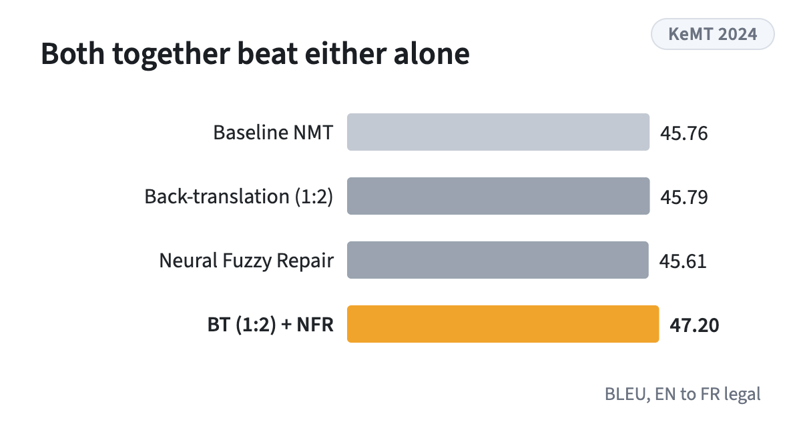

<!-- figstrip -->

<figure><figcaption>LLM-generated French text, back-translated, then fuzzy-match augmentation</figcaption></figure>
<figure><figcaption>BLEU on EN to FR legal text, Table 4</figcaption></figure>

<!-- /figstrip -->
A preliminary study on English to French legal translation. It generates synthetic French monolingual data with an LLM, back-translates it to expand the training data, then applies Neural Fuzzy Repair. Combining back-translation with fuzzy-match augmentation improves over both the baseline and fuzzy-match augmentation alone.

Research theme: [Machine translation](../research.qmd#machine-translation)
