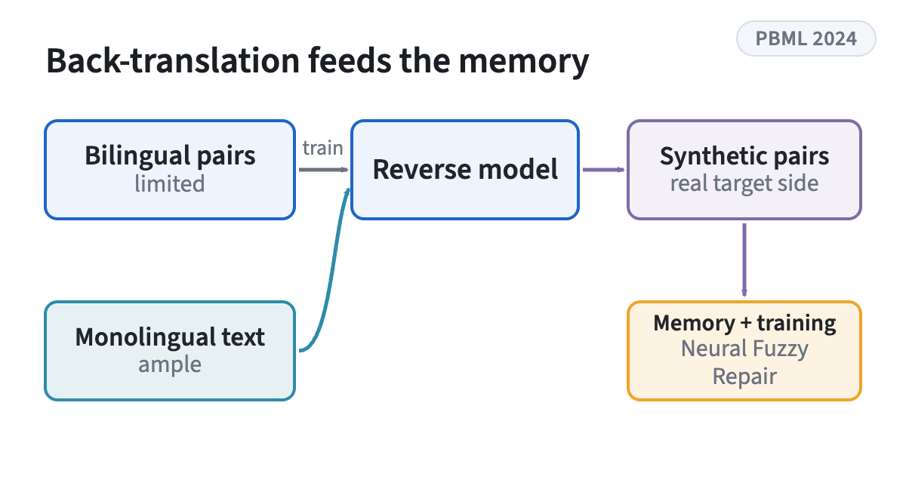
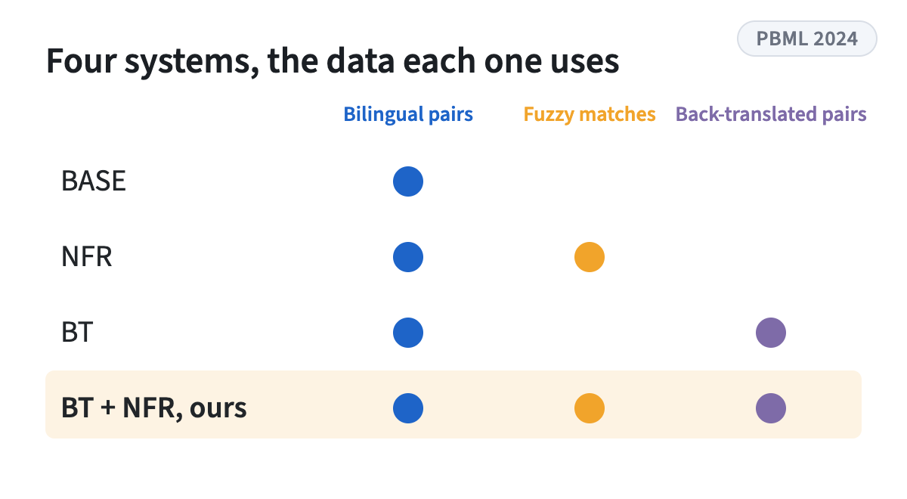
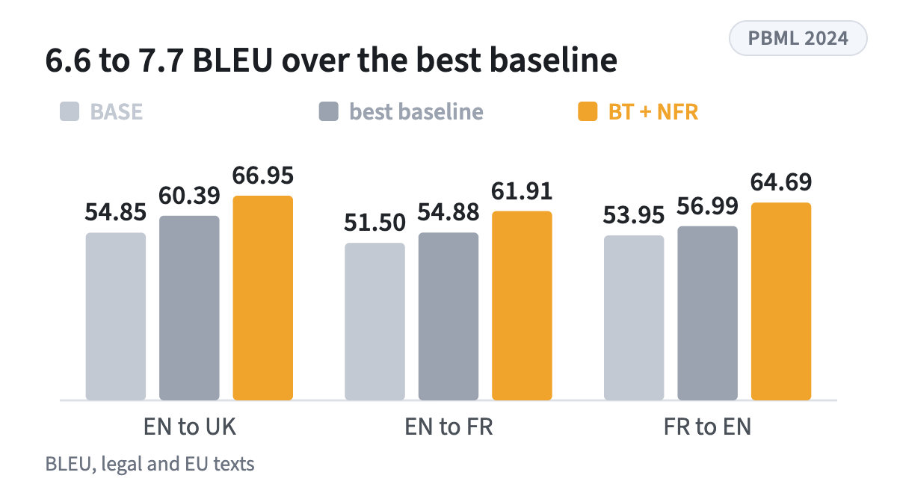

<!-- figstrip -->

<figure><figcaption>Back-translated pairs enlarge both the retrieval memory and the training data</figcaption></figure>
<figure><figcaption>The systems compared, each trained from scratch</figcaption></figure>
<figure><figcaption>BLEU in three directions, Table 5</figcaption></figure>

<!-- /figstrip -->
A journal study across three language directions and two specialized domains. It combines back-translation with Neural Fuzzy Repair to expand small parallel datasets with synthetic data. The combination gives large and statistically significant gains and beats several open and commercial LLMs on automatic metrics.

[DOI](https://doi.org/10.14712/00326585.030)

Research theme: [Machine translation](../research.qmd#machine-translation)
