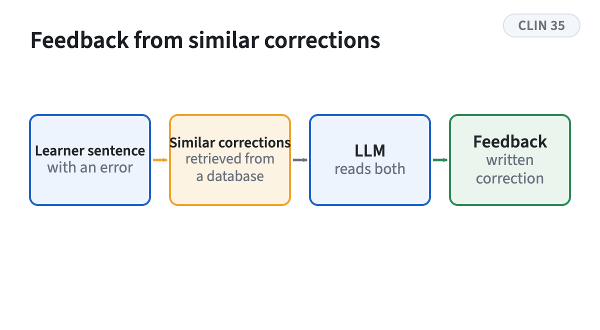
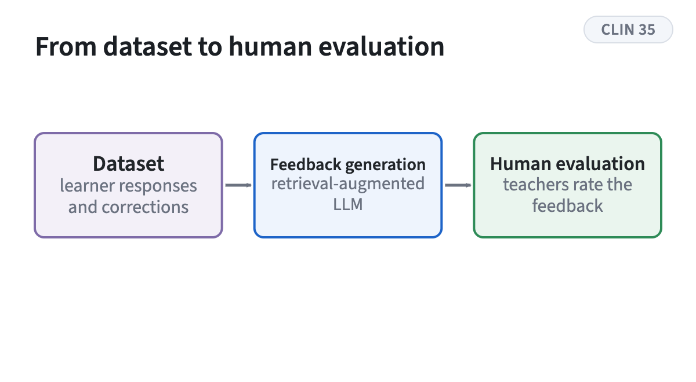

<!-- figstrip -->

<figure><figcaption>Retrieval-augmented generation of written corrective feedback</figcaption></figure>
<figure><figcaption>The three stages of the study</figcaption></figure>

<!-- /figstrip -->
Work on retrieval-augmented generation for automated written corrective feedback in second language acquisition, moving from dataset construction toward human evaluation.

Research theme: [Educational NLP](../research.qmd#educational-nlp)
