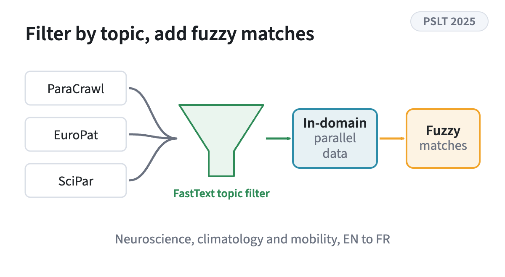
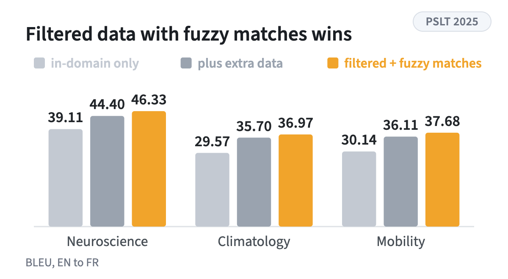
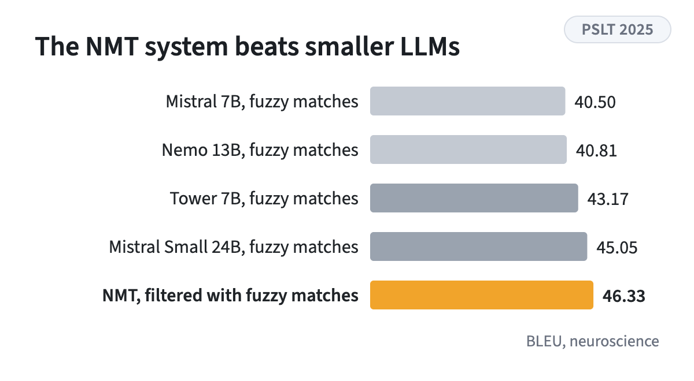

<!-- figstrip -->

<figure><figcaption>Topic filtering selects in-domain data before fuzzy-match augmentation</figcaption></figure>
<figure><figcaption>BLEU per domain, the filtered data with fuzzy matches wins everywhere</figcaption></figure>
<figure><figcaption>BLEU on neuroscience, NMT against four LLMs with fuzzy matches</figcaption></figure>

<!-- /figstrip -->
English to French scientific translation across neuroscience, climatology, and mobility. It adds topic filtering with FastText classifiers to select in-domain data before fuzzy-match augmentation. The best NMT configuration beats smaller LLMs, and the results are metric dependent.

Research theme: [Machine translation](../research.qmd#machine-translation)
