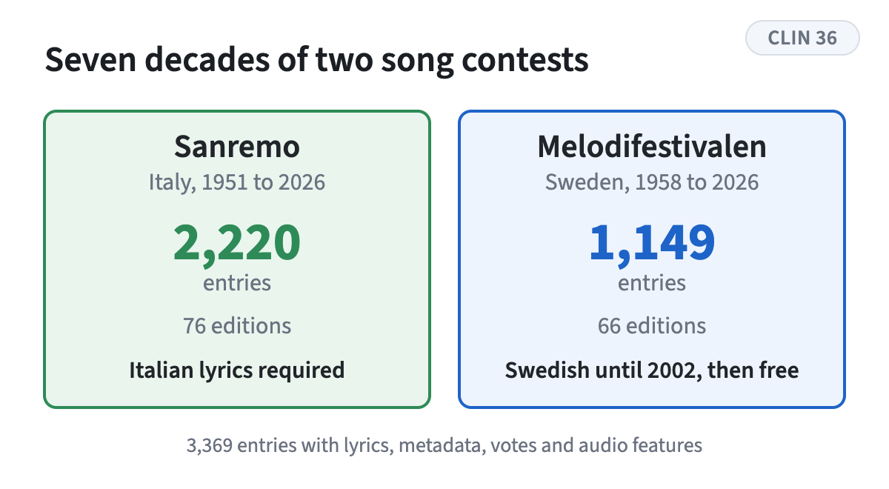
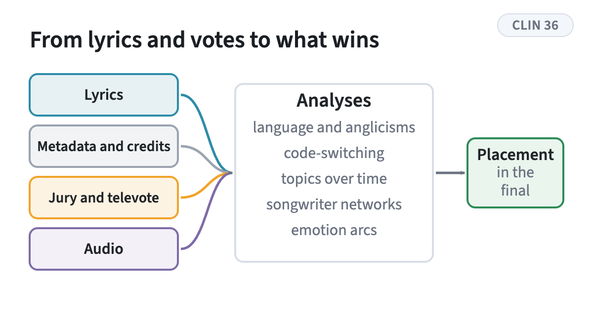
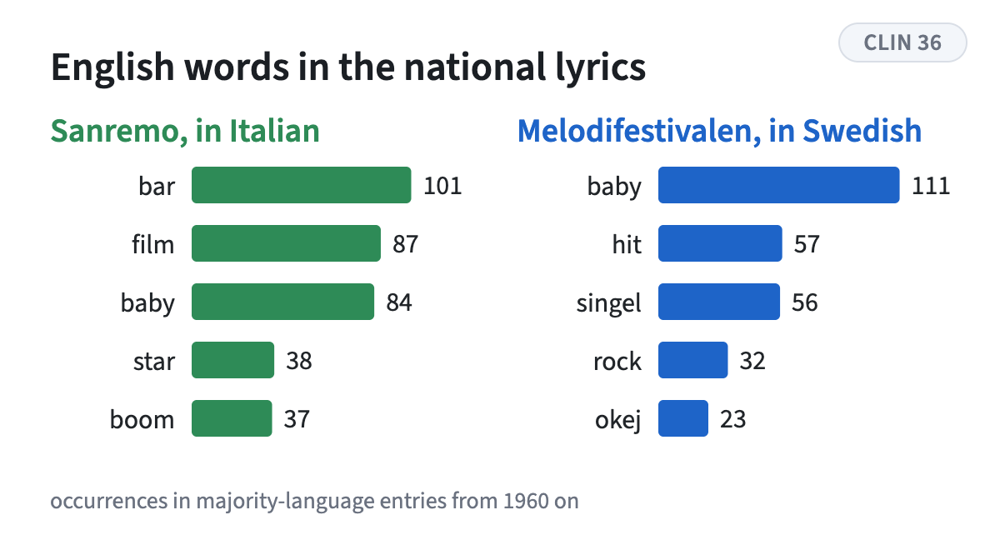

<!-- figstrip -->

<figure><figcaption>Two national contests with one rule that differs, 3,369 entries in all</figcaption></figure>
<figure><figcaption>Four sources, five analyses, one outcome to explain</figcaption></figure>
<figure><figcaption>The most frequent English loans in each contest</figcaption></figure>

<!-- /figstrip -->
The Sanremo Music Festival and Melodifestivalen are two of Europe's longest-running song contests, and they differ in one rule. Sanremo has required Italian lyrics throughout its history, while Melodifestivalen allowed any language from 2002 and English quickly became the norm. The corpus covers 3,369 entries from 1951 to 2026 with lyrics, metadata, jury and televote results and audio features. On top of it we track the language of the songs, English words inside Italian and Swedish lyrics, code-switching within songs, the topics across seven decades, the networks of songwriters, and the emotional arcs of lyrics and music, and we ask how these relate to a song's placement.

The derived data, lexicons and analysis tables are released as the [SanreMello Corpus on Hugging Face](https://huggingface.co/sanremello), with the [features dataset](https://huggingface.co/datasets/sanremello/smlc-features), a [corpus explorer](https://huggingface.co/spaces/sanremello/smlc-explorer) and the [poster](https://huggingface.co/spaces/sanremello/smlc). Code: [GitHub](https://github.com/TomMoeras/sanremello). Abstract in the [CLIN 36 book of abstracts](https://clin36.ai.vub.ac.be/CLIN36_book_of_abstracts.pdf), poster 30.
