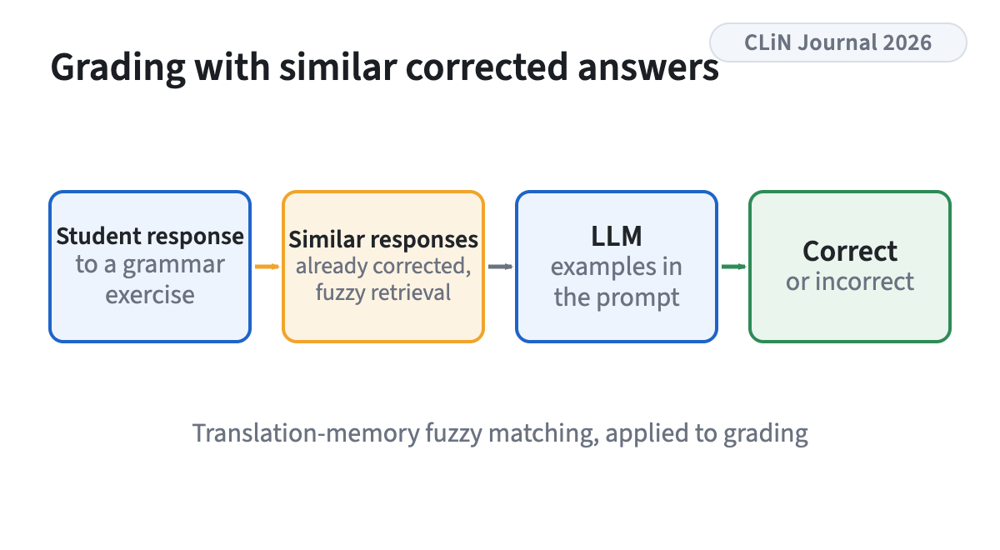
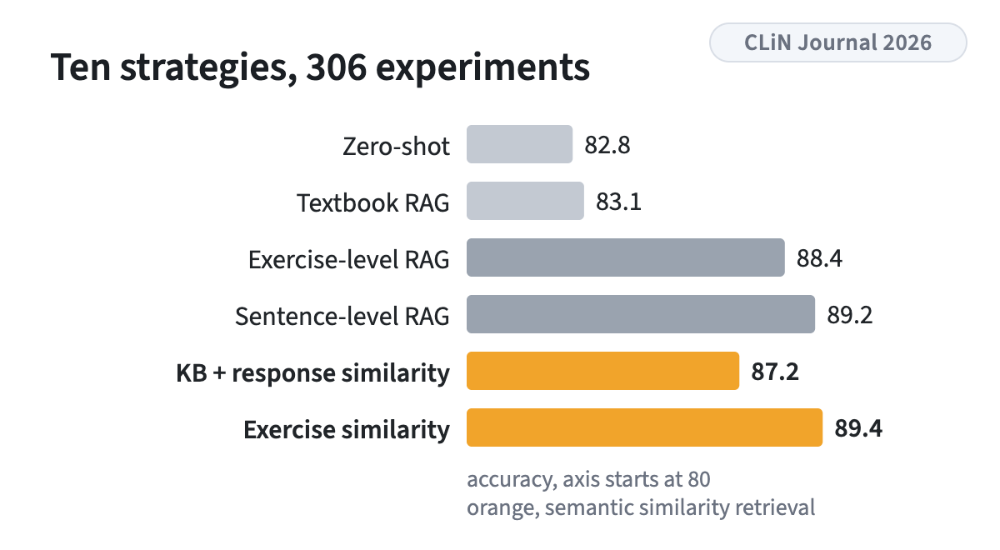
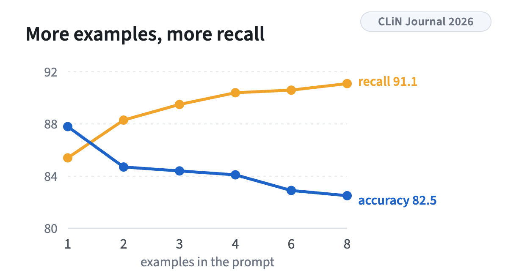

<!-- figstrip -->

<figure><figcaption>Fuzzy matching from translation memories, applied to automated grading</figcaption></figure>
<figure><figcaption>Accuracy per strategy, best shot count per topic</figcaption></figure>
<figure><figcaption>The accuracy and recall trade-off by shot count</figcaption></figure>

<!-- /figstrip -->
This work adapts translation-memory fuzzy matching to automated grading of short-answer language exercises. It evaluates ten retrieval strategies across 306 experiments and finds an accuracy and recall trade-off governed by the number of examples, with semantic retrieval generally beating non-semantic strategies.

Research theme: [Educational NLP](../research.qmd#educational-nlp)
