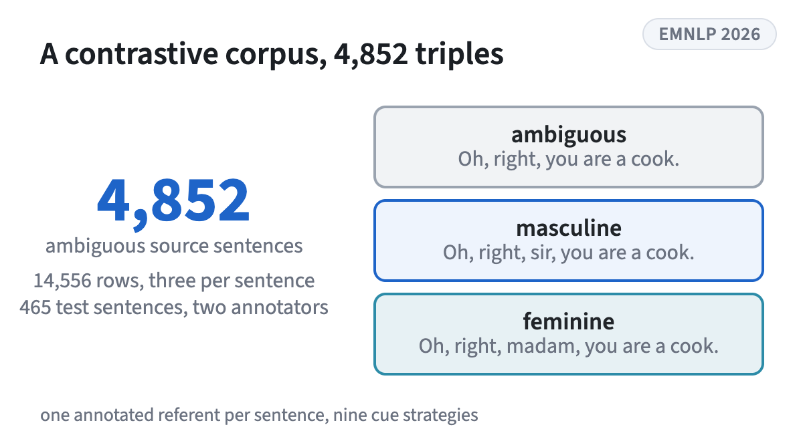
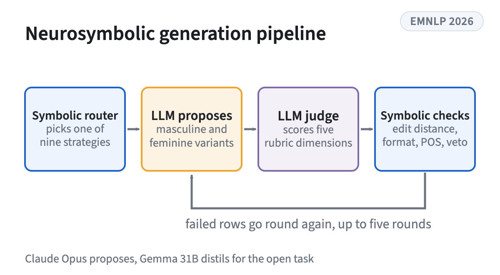
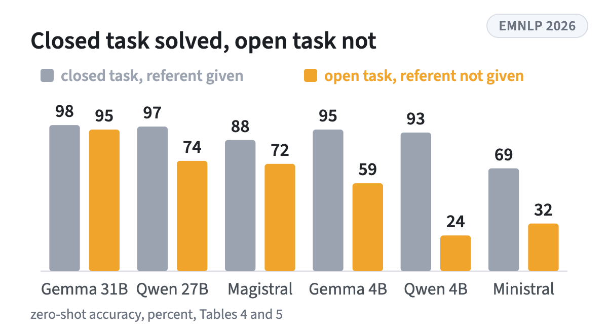
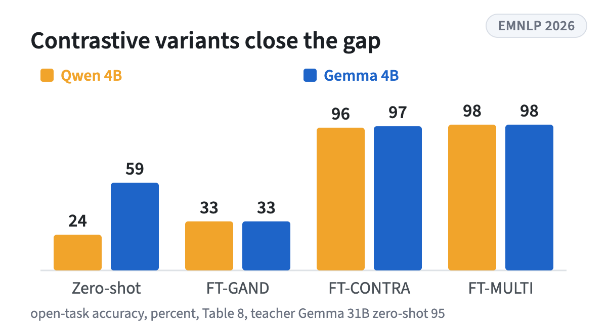

<!-- figstrip -->
<div class="figstrip" aria-label="Figures from the paper">
<figure><figcaption>4,852 gender-ambiguous sentences, each with a masculine and a feminine minimal pair, Table 1</figcaption></figure>
<figure><figcaption>A symbolic router, an LLM proposer, an LLM judge and symbolic validators with a repair loop, Figure 1</figcaption></figure>
<figure><figcaption>Every model drops when it must find the referent itself, most of all the small ones, Tables 4 and 5</figcaption></figure>
<figure><figcaption>Fine-tuning on the contrastive variants lifts two 4B students past the 31B teacher, Table 8</figcaption></figure>
</div>
<!-- /figstrip -->
Gender-ambiguous sentences are where translation systems quietly pick a gender. ContraGAND is a contrastive corpus of 4,852 natural gender-ambiguous English sentences, each minimally paired with a masculine and a feminine variant generated by a neurosymbolic pipeline and audited by two annotators. We use it to evaluate gender ambiguity detection in six open-weight LLMs under two framings: a closed task where the referent is given, which current models solve, and an open task where the model must find the referent itself, which opens a gap that grows as models shrink. Two failure modes dominate, a binding failure where a cross-clause cue is not linked back to its referent, and a format failure where small models never produce a parseable answer. Both are over-prediction of the ambiguous class rather than stereotype-driven errors. Prompting and decoding fixes do not close the gap, but fine-tuning on the contrastive variants does, and distillation from a 31B teacher lets a 4B student match and pass it.

```{=html}
<div class="resources" aria-label="Paper, code, data, models and demo with QR codes">
<a class="resource" href="https://aclanthology.org/2026.emnlp-main.485/"><span class="resource-kind">Paper</span><span class="resource-name">ACL Anthology</span></a>
<a class="resource" href="https://github.com/TomMoeras/ContraGAND"><span class="resource-kind">Code</span><span class="resource-name">GitHub</span></a>
<a class="resource" href="https://huggingface.co/datasets/TomMoeras/ContraGAND"><span class="resource-kind">Dataset</span><span class="resource-name">Hugging Face</span></a>
<a class="resource" href="https://huggingface.co/TomMoeras/contragand-qwen3.5-4b-closed"><span class="resource-kind">Model, closed task</span><span class="resource-name">Hugging Face</span></a>
<a class="resource" href="https://huggingface.co/TomMoeras/contragand-qwen3.5-4b-open"><span class="resource-kind">Model, open task</span><span class="resource-name">Hugging Face</span></a>
<a class="resource" href="https://huggingface.co/spaces/TomMoeras/contragand-demo"><span class="resource-kind">Demo</span><span class="resource-name">Hugging Face Spaces</span></a>
</div>
```

Research theme: [Fairness in language models](../research.qmd#fairness-in-language-models)
