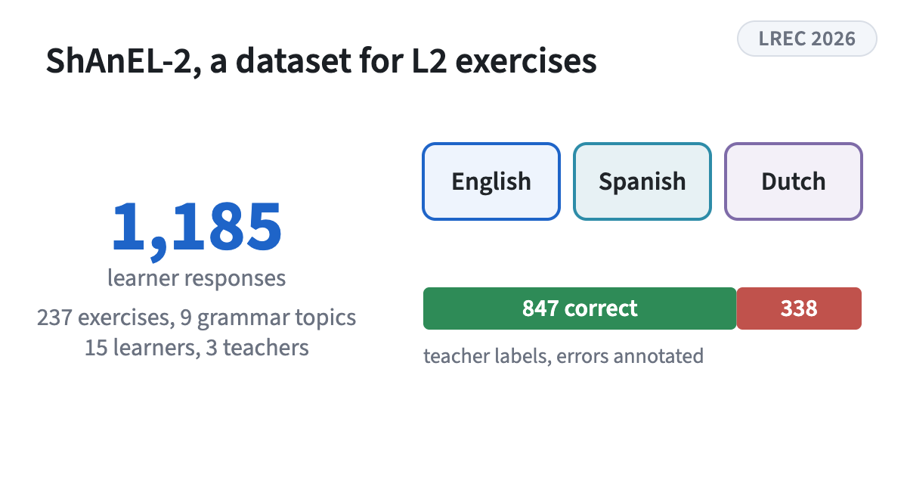
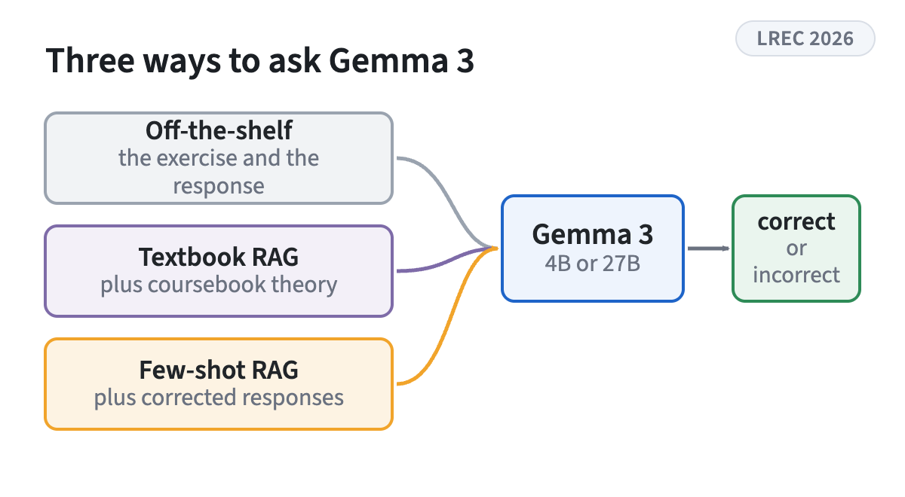
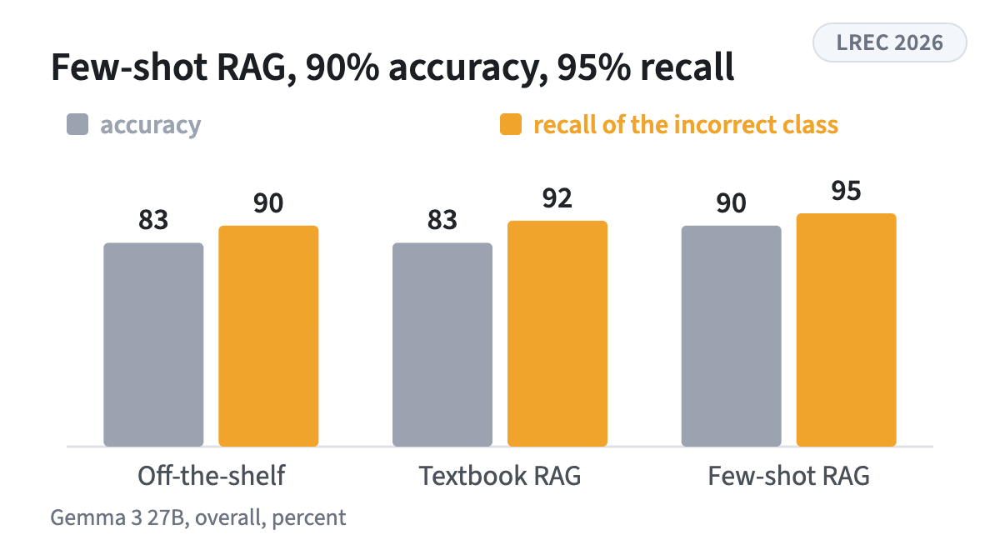

<!-- figstrip -->

<figure><figcaption>1,185 authentic learner responses in three languages with teacher corrections</figcaption></figure>
<figure><figcaption>Off-the-shelf, textbook RAG and few-shot RAG, benchmarked on the dataset</figcaption></figure>
<figure><figcaption>Examples beat theory, Table 2</figcaption></figure>

<!-- /figstrip -->
Presents ShAnEL-2, a multilingual dataset of 1,185 authentic learner responses across English, Spanish, and Dutch with expert teacher corrections. It benchmarks Gemma 3 in three setups and shows that few-shot retrieval-augmented generation reaches the best accuracy and recall.

Research theme: [Educational NLP](../research.qmd#educational-nlp)
