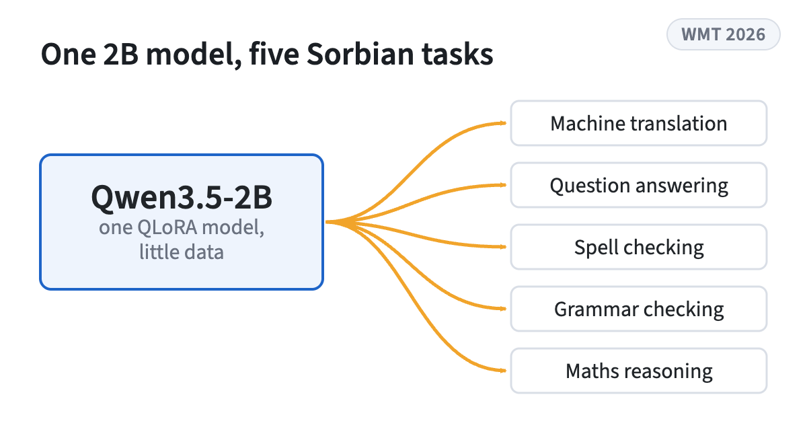
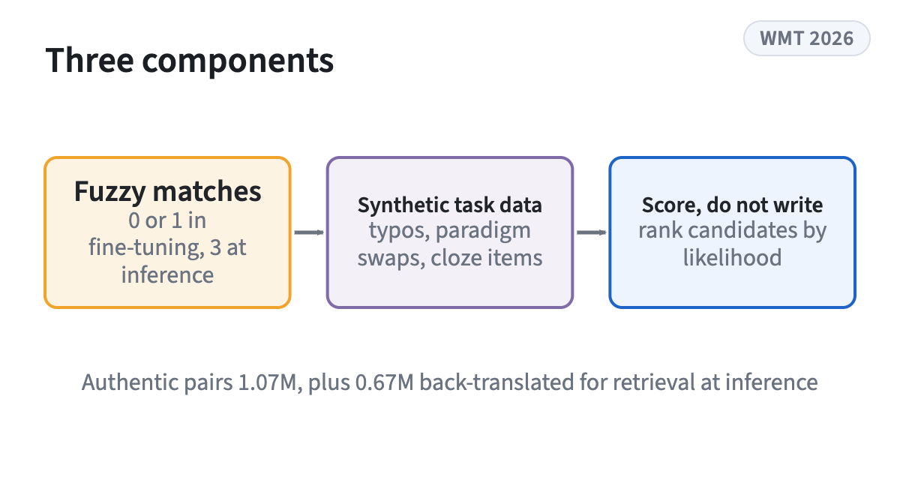
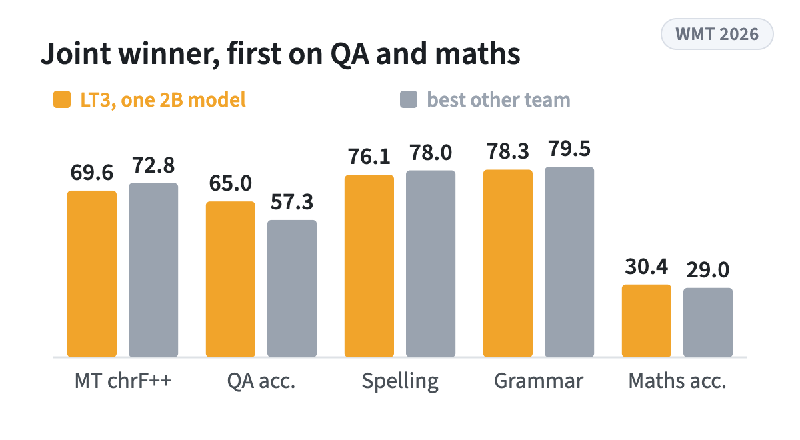

<!-- figstrip -->
<div class="figstrip" aria-label="Figures from the paper">
<figure><figcaption>One 2B model serves five Sorbian tasks</figcaption></figure>
<figure><figcaption>Fuzzy matches by stage, synthetic task data, scoring instead of writing</figcaption></figure>
<figure><figcaption>Official results, 22 rank points, first or second on every task</figcaption></figure>
</div>
<!-- /figstrip -->
LT3's submission to the WMT 2026 shared task on Multitask LLMs with Limited Resources for Upper Sorbian (hsb) and Lower Sorbian (dsb). A single QLoRA-fine-tuned Qwen3.5-2B model handles machine translation, question answering, spell checking, grammar checking, and maths reasoning, combining fuzzy-match retrieval (over authentic and back-translated pools), synthetic task data, and a scoring-based inference system. The primary system was the joint winner of the Sorbian track, ranking first or second across all five tasks.

```{=html}
<div class="resources" aria-label="Paper, code, models and data with QR codes">
<a class="resource" href="https://www2.statmt.org/wmt26/pdf/2026.wmt-1.210.pdf"><span class="resource-kind">Paper</span><span class="resource-name">WMT 2026 proceedings</span></a>
<a class="resource" href="https://github.com/TomMoeras/wmt26-lt3-sorbian"><span class="resource-kind">Code</span><span class="resource-name">GitHub</span></a>
<a class="resource" href="https://huggingface.co/TomMoeras/wmt26-lt3-sorbian"><span class="resource-kind">Models</span><span class="resource-name">Hugging Face</span></a>
<a class="resource" href="https://huggingface.co/datasets/TomMoeras/wmt26-lt3-sorbian-data"><span class="resource-kind">Dataset</span><span class="resource-name">Hugging Face</span></a>
</div>
```

Research theme: [Machine translation](../research.qmd#machine-translation)
